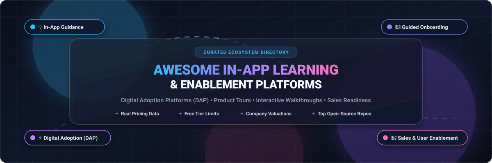
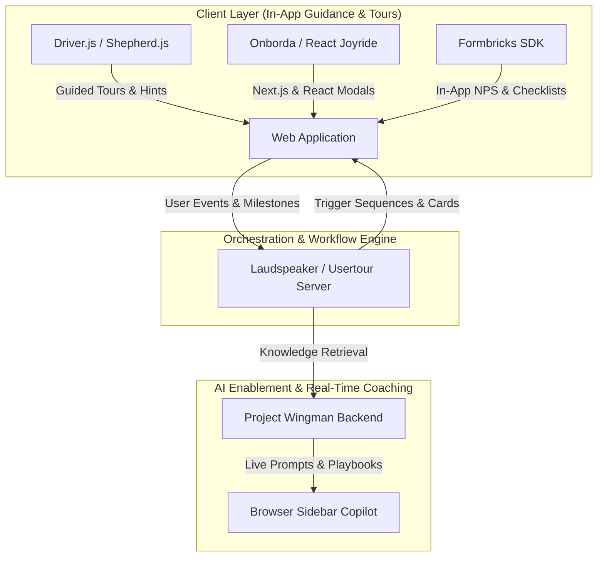

  

 

---

# 🚀 Awesome In-App Learning & Enablement Tools

> 📚 **A curated directory of Digital Adoption Platforms (DAP), interactive product tours, in-app microlearning, guided user onboarding, and contextual sales readiness tools.**

Welcome to the definitive ecosystem guide for **In-App Learning, Digital Adoption & User Enablement**. Modern software products must minimize time-to-value ($TTV$), eliminate user friction, and guide users directly in the flow of work. Whether you are searching for enterprise Digital Adoption Platforms (DAPs), sales coaching copilots, or lightweight, open-source product tour libraries to avoid per-MAU subscription taxes, this guide tracks the entire ecosystem with verified starting prices, exact free plan limits, and valuation benchmarks.

---

## 📑 Table of Contents

- [📊 Sector Overview & Market Dynamics](#-sector-overview--market-dynamics)
- [🏢 SaaS & Hosted Platforms](#-saas--hosted-platforms)
- [🛠️ Open-Source GitHub Projects](#️-open-source-github-projects)
- [🏗️ Architectural Stacks for Custom Guidance](#️-architectural-stacks-for-custom-guidance)
- [🤝 How to Contribute](#-how-to-contribute)
- [⚖️ Disclaimer & Compliance](#️-disclaimer--compliance)
- [📈 Star History](#-star-history)
- [💖 Support & Community](#-support--community)

---

## 📊 Sector Overview & Market Dynamics

The combined global market for **Digital Adoption Platforms (DAP)** and **In-App Learning & Sales Enablement** is estimated at **$6.5B to $8.5B in 2025–2026**, expanding rapidly at a compound annual growth rate (**CAGR of 15%–21%**) toward **$20B+ by the early 2030s**, propelled by hybrid workforce onboarding, cloud application proliferation, and product-led growth (PLG) motions.

The market structure is **moderately fragmented rather than a "winner-take-all" landscape**:
- **Enterprise Core**: Large incumbents like **Salesforce**, **SAP (WalkMe)**, **Seismic**, **Highspot**, and **Pendo** dominate large-scale Global 2000 corporate contracts, packaging end-to-end RevOps analytics, cross-application governance, and deep CRM integrations.
- **Mid-Market & Developer Tail**: The ecosystem features strong fragmentation across agile self-serve platforms (**Appcues**, **Userpilot**, **Spekit**) and developer-first **open-source frameworks** (**Driver.js**, **Intro.js**, **Shepherd.js**, **Formbricks**). Teams frequently adopt open-source tour kits to avoid punitive per-MAU SaaS pricing escalations, preserve client-side data privacy, and maintain complete design system sovereignty.

---

## 🏢 SaaS & Hosted Platforms

The table below lists leading commercial SaaS platforms ordered by company size (**Valuation / Market Cap / Revenue descending**), along with verified starting tier pricing and specific free plan / trial limitations.

| 🏢 Product / Platform | 📈 Company Size (Valuation / Revenue) | 🎯 Focus & Core Capabilities | 💵 Starting Tier Pricing | 🎁 Free Tier / Free Trial Limits |
| :--- | :--- | :--- | :--- | :--- |
| **[Salesforce Learning Paths](https://www.salesforce.com/)** | **~$280B–$300B Market Cap** (~$38B ARR) | Native in-app Trailhead learning paths, CRM task guidance, and contextual onboarding inside Salesforce CRM. | **$25/user/month** (Starter Suite; included free with Sales/Service Cloud up to Enterprise $165/user/mo); standalone Sales Enablement add-on starts at **$100/user/mo** (billed annually). | **30-day full-featured free trial** of Sales Cloud (includes Learning Paths builder, Trailhead module assignment, and onboarding journeys for up to 5 users). |
| **[Highspot Training](https://www.highspot.com/)** | **$3.5B Valuation** (~$150M+ ARR) | Enterprise sales enablement platform with contextual playbooks, video coaching, training pathways, and buyer engagement analytics. | **$50/user/month** (billed annually at ~$600/user/yr; average enterprise deployment starts at **$15,000–$90,000/yr ACV** with seat minimums). | **14-day guided proof-of-concept trial** (No permanent free plan; sandbox environment granted for up to 5 sales reps and 3 interactive coaching pathways upon sales consultation). |
| **[Lessonly by Seismic](https://www.seismic.com/)** | **$3.0B Valuation** (~$300M+ ARR) | Sales readiness and training software featuring lesson authoring, roleplay simulations, and in-workflow enablement widgets. | **$30/user/month** (billed annually, base team tier starting at **$3,600/yr** for 10 seats; enterprise packages average **$20,000–$45,000/yr**). | **14-day guided evaluation sandbox** (No permanent free plan; interactive demo sandbox limited to 5 learner accounts, 3 practice lessons, and simulated grading). |
| **[Pendo](https://www.pendo.io/)** | **$2.6B Valuation** (~$200M+ ARR) | Product analytics and digital guidance platform offering in-app walkthroughs, tooltips, lightboxes, and Net Promoter Score (NPS) surveys. | **$7,000/year** (~$583/month) for Starter tier (up to 2,000 MAU); Core and Ultimate enterprise packages start at **$15,000+/year** based on MAU volume. | **Free forever plan capped at 500 MAU** (includes core analytics, unlimited feature click tracking, basic in-app walkthrough guides, and 12-month data retention). |
| **[WalkMe](https://www.walkme.com/)** *(SAP)* | **$1.5B Valuation** (Acquired by SAP; ~$270M ARR) | Enterprise Digital Adoption Platform (DAP) with AI workflow automation, cross-app task guidance, and employee tech adoption analytics. | **$15 to $35/user/month** (billed annually; minimum starting contract ranges from **$14,400/yr to $39,000/yr** based on MAU & app scope). | **14-day sales-assisted PoC sandbox** (No permanent free tier; trial restricted to 1 target web application, 3 guided walkthroughs, and up to 50 test user assists). |
| **[Mindtickle](https://www.mindtickle.com/)** | **$1.2B Valuation** (~$60M+ ARR) | Revenue readiness platform combining onboarding pathways, AI conversation intelligence (Call AI), and coaching assessments. | **$30 to $45/user/month** (billed annually; baseline departmental entry contract starts around **$20,000/yr** with mandatory onboarding package). | **14-day guided proof-of-concept sandbox** (No permanent free tier; PoC limited to 5 learner licenses with access to pre-built sales readiness templates and video roleplay). |
| **[Whatfix](https://whatfix.com/)** | **$900M–$950M Valuation** (~$60M+ ARR) | Enterprise DAP offering in-app tooltips, step-by-step interactive flows, self-help launcher widgets, and SCORM LMS export. | **$2,000/month** (Standard plan billed annually at **$24,000/yr** for single-application deployments; median contract ~$32,000/yr). | **14-day assisted pilot sandbox** (No self-serve free tier; trial access granted via sales engineering for 1 application and up to 5 interactive flow drafts). |
| **[Showpad Coach](https://www.showpad.com/)** | **~$500M Valuation** (~$80M+ ARR) | B2B sales enablement and readiness platform featuring PitchIQ video pitch practice, interactive quizzes, and microlearning modules. | **$35/user/month** (Essential tier billed annually at **$4,200/yr** minimum 10 seats; Plus/Coach tiers start at **$50/user/mo**). | **14-day sales-assisted trial** (No permanent free tier; sandbox limited to 10 user seats with full access to PitchIQ video evaluation and course authoring). |
| **[Spekit](https://www.spekit.com/)** | **~$200M Valuation** (~$15M+ ARR) | Just-in-time microlearning, digital enablement cards ('Speks'), and Chrome extension tooltips embedded across Salesforce, Slack, & web apps. | **$15/user/month** (Lite tier billed annually, minimum 10 seats = **$1,800/yr**; Pro tier at **$25/user/mo**). | **14-day sales-guided sandbox trial** (No permanent free plan; includes full Chrome extension integration and creation of up to 25 custom 'Spek' cards for 5 test users). |
| **[Appcues](https://www.appcues.com/)** | **~$150M Valuation** (~$25M ARR) | No-code product onboarding, modal announcements, slideouts, interactive product tours, and user activation tracking. | **$249/month** (Essentials plan billed annually at **$2,988/yr** for up to 2,500 MAU; Growth tier starts at **$879/mo**). | **14-day self-serve free trial** (Full access to visual Chrome extension builder, in-app flows, checklists, and up to 5 published experiences for test users). |
| **[Brainshark](https://www.brainshark.com/)** *(Bigtincan)* | **~$86M Acquisition Value** (Bigtincan Market Cap ~$130M) | Sales training presentation authoring, video coaching assessments, and machine scoring for rep readiness. | **$83/user/month** (billed annually; Pro tier starting contract around **$10,000/yr** with a 10-to-20 user minimum threshold). | **7-day sales-assisted evaluation demo** (No permanent free tier; restricted to 3 test training presentations and simulated AI scoring for 5 reps). |
| **[Userpilot](https://userpilot.com/)** | **~$60M Valuation** (~$12M ARR) | Product growth and user onboarding platform featuring in-app checklists, tooltips, flow branching, and micro-surveys. | **$249/month** (Starter tier billed annually at **$2,988/yr** for up to 2,000 MAU; Traction tier starts at **$499/mo**). | **14-day self-serve free trial** (Unlimited flows, tooltips, and checklists across up to 2,000 test user sessions with Chrome extension builder). |

---

## 🛠️ Open-Source GitHub Projects

Explore battle-tested, developer-friendly open-source frameworks for product tours, user onboarding, digital adoption, and in-app guidance. 

> 💡 **Sorted descending by GitHub star count.** Each repository includes its official social star badge directly linking to its stargazers page.

1. **[Driver.js](https://github.com/kamranahmedse/driver.js)**   
   ✨ Ultra-lightweight (~5KB gzipped), zero-dependency, vanilla JavaScript engine to drive user focus across your web application. Highly customizable popovers, keyboard navigation, smooth highlighting overlay, and multi-step walkthrough support.  
   `License: MIT` • `Stack: TypeScript / Vanilla JS`

2. **[Intro.js](https://github.com/usablica/intro.js)**   
   ✨ The most widely recognized step-by-step product guide and user onboarding library. Supports floating tooltips, progress bars, keyboard controls, and responsive positioning across modern web applications.  
   `License: AGPL-3.0 / Commercial` • `Stack: JavaScript / CSS`

3. **[Shepherd.js](https://github.com/shipshapecode/shepherd)**   
   ✨ Fully-featured digital adoption platform (DAP) and tour library built on Floating UI. First-class official wrapper support for React, Vue.js, Angular, Ember, and Svelte. Supports custom modal steps, dark modes, and event tracking hooks.  
   `License: AGPL-3.0 / Commercial` • `Stack: TypeScript / Framework Wrappers`

4. **[Formbricks](https://github.com/formbricks/formbricks)**   
   ✨ Open-source experience management & in-app micro-survey suite. Essential companion to in-app learning for capturing user feedback at critical onboarding milestones, CSAT, and NPS directly inside web and mobile apps.  
   `License: AGPL-3.0` • `Stack: Next.js / TypeScript / Tailwind CSS`

5. **[React Joyride](https://github.com/gilbarbara/react-joyride)**   
   ✨ Production-grade React guided tour library powering onboarding flows at thousands of companies. Provides customizable beacons, controlled/uncontrolled tour modes, custom tooltips, scrolling anchors, and Next.js App Router compatibility.  
   `License: MIT` • `Stack: React / TypeScript`

6. **[Bootstrap Tour](https://github.com/sorich87/bootstrap-tour)**   
   ✨ Quick and easy product tours built on Twitter Bootstrap popovers. Allows developers to create clean guided walkthroughs with automatic step progression and local storage state persistence.  
   `License: Apache-2.0` • `Stack: JavaScript / Bootstrap`

7. **[Hopscotch](https://github.com/linkedin/hopscotch)**   
   ✨ Framework designed by LinkedIn to make it simple for developers to embed product tours into their pages. Includes multi-page tour support, custom callbacks, internationalization (i18n), and robust DOM state restoration.  
   `License: Apache-2.0` • `Stack: JavaScript / CSS`

8. **[Reactour](https://github.com/elrumordelaluz/reactour)**   
   ✨ Tourist guide component package for React apps. Smooth SVG mask transitions highlighting target elements, customizable badges, step dots, and keyboard navigation controls.  
   `License: MIT` • `Stack: React / TypeScript`

9. **[Laudspeaker](https://github.com/laudspeaker/laudspeaker)**   
   ✨ Open-source customer engagement and onboarding platform (alternative to Appcues, Pendo, Braze). Design visual multi-channel onboarding journeys, event-triggered notifications, and interactive in-app guides with self-hosting support.  
   `License: AGPL-3.0` • `Stack: TypeScript / Node.js`

10. **[Vue Tour](https://github.com/pulsardev/vue-tour)**   
    ✨ Lightweight, customizable tour plugin for Vue.js applications (supporting Vue 2 and Vue 3). Provides easy step configuration, slot-based UI overrides, and custom CSS styling for contextual onboarding.  
    `License: MIT` • `Stack: Vue.js / JavaScript`

11. **[Usertour](https://github.com/usertour/usertour)**   
    ✨ Open-source user onboarding and product adoption platform designed as a self-hostable alternative to Userflow and Appcues. Create interactive tours, checklists, and feedback surveys with complete control over user data.  
    `License: AGPL-3.0` • `Stack: TypeScript / Docker`

12. **[Onborda](https://github.com/uixmat/onborda)**   
    ✨ Modern, animated product tour library specifically designed for Next.js and Tailwind CSS applications. Powered by Framer Motion with customizable steps, floating cards, and route changes.  
    `License: MIT` • `Stack: Next.js / React / Framer Motion`

13. **[Joyride](https://github.com/zurb/joyride)** *(Foundation)*   
    ✨ Foundation's classic tour plugin for guiding users through responsive interfaces, feature releases, and onboarding flows with customizable modal tooltips.  
    `License: MIT` • `Stack: JavaScript / jQuery`

14. **[Tourguide.js](https://github.com/LikaloLLC/tourguide.js)**   
    ✨ Simple, responsive, vanilla JS library for creating interactive walkthroughs, feature demonstrations, and product tours with zero dependencies.  
    `License: MIT` • `Stack: TypeScript / JavaScript`

15. **[ngx-tour](https://github.com/isaacplmann/ngx-tour)**   
    ✨ Product tour framework built natively for Angular applications. Ships with pre-packaged adapters for ng-bootstrap, ngx-bootstrap, and Angular Material popovers.  
    `License: MIT` • `Stack: Angular / TypeScript`

16. **[Tour Kit](https://github.com/domidex01/tour-kit)**   
    ✨ Modular developer library for code-first user onboarding. Extremely lightweight (<8KB gzipped), delivering composable packages for product tours, checklist widgets, hints, and local analytics tracking.  
    `License: MIT` • `Stack: TypeScript`

17. **[UDAN Agent Client](https://github.com/Digital-Assistant/Digital_Assistant_Client)**   
    ✨ Open-source AI-powered Digital Adoption Platform (DAP) client. Uses generative AI sequences and crowdsourced step-by-step guides for contextual accessibility and in-app assistive guidance.  
    `License: AGPL-3.0` • `Stack: Python / JavaScript`

18. **[Project Wingman Backend](https://github.com/avinashgaurav/project-wingman)**   
    ✨ Self-hosted AI sales enablement and real-time coaching infrastructure. Orchestrates live agent analysis (sentiment, agenda pacing, objections, and validation) during calls and training simulations.  
    `License: MIT` • `Stack: Python / LLM Agents`

19. **[Project Wingman ClientLens](https://github.com/avinashgaurav/project-wingman-ClientLens)**   
    ✨ Open-source browser extension sidebar copilot providing real-time in-app enablement, talking points, and live coaching prompts grounded in custom enterprise knowledge bases.  
    `License: MIT` • `Stack: TypeScript / Chrome Extension`

---

## 🏗️ Architectural Stacks for Custom Guidance

For engineering teams seeking to assemble a **100% self-hosted, sovereign in-app learning and enablement stack**:

- **In-App Step Tour & Guidance**: Use **[Driver.js](https://github.com/kamranahmedse/driver.js)** or **[Shepherd.js](https://github.com/shipshapecode/shepherd)** for vanilla/multi-framework setups, or **[React Joyride](https://github.com/gilbarbara/react-joyride)** / **[Onborda](https://github.com/uixmat/onborda)** for modern React and Next.js applications.
- **Micro-Surveys & Feedback Loops**: Embed **[Formbricks](https://github.com/formbricks/formbricks)** to measure completion rates and gather user feedback at critical onboarding milestones.
- **Event-Driven Onboarding Triggers**: Deploy **[Laudspeaker](https://github.com/laudspeaker/laudspeaker)** or **[Usertour](https://github.com/usertour/usertour)** to manage event triggers, multi-channel guidance, and automated re-engagement flows.
- **AI Sales & Workplace Coaching**: Self-host **[Project Wingman](https://github.com/avinashgaurav/project-wingman)** to deliver LLM-driven guidance and real-time coaching directly in the browser.

---

## 🤝 How to Contribute

Contributions are welcome and highly appreciated! To maintain the quality and accuracy of this repository:

1. 🍴 **Fork the repository** to your GitHub account.
2. 🌿 **Create a topic branch**: `git checkout -b add-tool-name`.
3. 📝 **Add or update entries**:
   - Provide verified product name, official website / repository link.
   - For SaaS products: Include specific starting tier prices (avoiding generic "Custom" text), specific free plan limits / trial days, and company size metrics.
   - For Open-Source projects: Include the standard `` badge, license, and brief description.
4. 🚀 **Submit a Pull Request** with a concise description of your changes.

---

## ⚖️ Disclaimer & Compliance

- **Community Curated**: This repository is maintained as an open educational and architectural resource; listings do not represent commercial endorsements.
- **Licensing Transparency**: Note the licensing terms of open-source frameworks (e.g., AGPL-3.0 vs. MIT) prior to incorporating them into commercial proprietary applications.
- **Data Privacy & Compliance**: In-app guidance overlays and tracking telemetry must strictly comply with regional data protection standards (GDPR, CCPA, SOC2 Type II, and HIPAA).

---

## 📈 Star History

---

## 💖 Support & Community

Thank you so much for exploring and supporting **Awesome-In-App-Learning-Enablement**! 🙌

If this curated repository helped you evaluate tools, streamline digital adoption, or design superior onboarding flows for your users, please consider showing your support:

- ⭐ **Star this repository** to help other developers and product teams discover it.
- 🍴 **Fork and contribute** new tools, benchmarks, and corrections.
- 📢 **Share with your community** across Twitter/X, LinkedIn, Discord, and Slack.
- ☕ **Buy a coffee / Sponsor**: Support continuous curation and maintenance via the [GitHub Sponsor Dashboard](https://github.com/sponsors/ishandutta2007).

---

Made with ❤️ by [Ishandutta2007](https://github.com/ishandutta2007) and the open-source community.  
*Empowering users with contextual, in-app guidance everywhere.*

